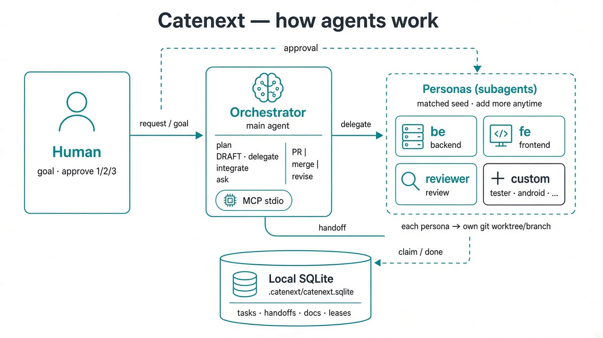

<p align="center">
  
</p>

<h1 align="center">Catenext CLI</h1>

<p align="center">
  Antrean lokal untuk agen AI coding — claim, handoff, task berikutnya. Tanpa Cloud.
</p>

<p align="center">
  <a href="https://www.npmjs.com/package/catenext"></a>
  <a href="LICENSE"></a>
  <a href="https://nodejs.org/"></a>
</p>

Catenext mengunci task agar dua agen tidak bentrok, meneruskan handoff ke agen berikutnya,
dan membuka task baru hanya setelah dependensinya selesai. Semua state ada di komputer Anda
(SQLite) — tanpa akun, tanpa login, tanpa dashboard.

Paket ini berisi CLI `catenext` dan server MCP stdio untuk Claude Code, Cursor, Codex,
Antigravity, OpenCode, dan agen lain.

[npm](https://www.npmjs.com/package/catenext) ·
[Changelog](CHANGELOG.md) ·
[Laporkan masalah](https://github.com/TenkuryuCode/catenext-cli/issues)

<p align="center">
  
</p>

<p align="center"><em>Manusia → orchestrator → persona (bisa ditambah) di worktree sendiri → SQLite lokal.</em></p>

## Mulai cepat

Butuh Node.js **22.12+**.

```bash
npm install -g catenext
cd ~/code/proyek-anda
catenext init --platform cursor          # tip: tambah --dry-run dulu, atau --yes untuk default
catenext verify --platform cursor
```

Restart IDE/CLI, lalu percayai server MCP `catenext` jika diminta.
`catenext mcp` adalah proses **stdio** (bukan HTTP).

Orchestrator mengikuti **bahasa Anda** di chat; stub persona dan nama tool tetap **Inggris**.

Dokumen lokal (`sync-board`, blueprint): `catenext doc save|get` — baca ringkas dengan
`--outline` / `--section`, arsip dengan `doc archive|restore` ([detail](#dokumen-dan-skill)).

**v0.17.0 (source; npm belum publish):**
- Epic run berbatas: `catenext epic run preview|start|resume|pause|close|review|verify`
- Katalog skill terpadu: `skill list --user-skills` / `init|sync --user-skills` (read-only)
- Context reviewer kompak: `review claim|refresh --include-context`
- Ringkasan + arsip epic lokal: `epic summary|archive|restore`

| Klien | `--platform` | Konfigurasi |
| --- | --- | --- |
| Claude Code | `claude-code` | `.mcp.json` + `CLAUDE.md` |
| Cursor | `cursor` | `.cursor/mcp.json` + `.cursor/CATENEXT.md` |
| Codex | `codex` | `.codex/config.toml` + `.codex/CATENEXT.md` |
| Antigravity | `antigravity` | `.agents/mcp_config.json` + `.agents/CATENEXT.md` |
| OpenCode | `opencode` | setup OpenCode + `.opencode/CATENEXT.md` |
| VS Code | `vscode` | `.vscode/mcp.json` + `.vscode/CATENEXT.md` + `.github/agents/` |

`init` menulis config, entri MCP, `.gitignore`, **`CATENEXT.md`**, pointer platform, blok
`AGENTS.md`, dan seed persona **yang cocok** dengan stack/repo. Tambah/hapus persona kapan saja:
`catenext persona set|remove` — stub IDE di-regen otomatis (`--no-sync` untuk lewati;
`--platform` untuk membatasi). Skill: `catenext skill list|create|set|remove|load`
(tambah `--user-skills` untuk katalog global pengguna, read-only)
([detail](#orchestrator-dan-persona) · [skill](#dokumen-dan-skill) · [template](#template-lintas-proyek)).
`catenext remove` membersihkan setup (file SQLite tetap, kecuali Anda hapus sendiri).

## Memperbarui Catenext

**1. Paket CLI**

```bash
catenext --version
npm install -g catenext@latest
```

**2. Setup di setiap repo** (setelah CLI baru)

```bash
catenext sync --platform cursor --force
catenext verify --platform cursor
```

Lalu **restart IDE**. Lihat [CHANGELOG.md](CHANGELOG.md).

| Ikut `sync` | Tidak disentuh |
| --- | --- |
| MCP, pointer, `AGENTS.md`/`CATENEXT.md` (bertanda Catenext), stub persona, skill bawaan baru | SQLite (task/docs), skill yang sudah Anda edit |

Tips: setelah 0.10/0.11 cek worktree, doctor, template, dan watch di changelog.
Jangan commit `.catenext/catenext.sqlite` atau cache.

## Master prompt (salin ke chat)

**Untuk Anda (manusia):**

1. Tempel blok di bawah sebagai **pesan pertama** di chat orchestrator (repo kosong, repo baru, maupun proyek yang sudah berjalan).
2. Bila Catenext belum terpasang, izinkan agen memeriksa Node, memasang `catenext`, dan menjalankan `init` + `verify` — jawab dalam bahasa Anda.
3. Setelah `verify`, **restart IDE** dan percayai server MCP `catenext`.
4. Setiap kali agen berhenti di gerbang manusia, cukup balas `1` / `2` / `3` (`approve` · `revise` · `next`) atau pilih `PR` / `merge`.

Setelah `init`, root **`CATENEXT.md`** + **`AGENTS.md`** menjaga aturan yang sama di repo (diperbarui lewat `catenext sync --force`).

```markdown
# Catenext · Orchestrator Master Prompt

You are the **Catenext Orchestrator** for this repository. Never act as a worker (`agent_alias`) or write persona implementation tasks yourself unless the human explicitly asks.

## 1. Language & Style
- Mirror the human's language for all questions, summaries, and approval gates.
- Keep persona stubs, MCP tool names, and CLI commands in English.
- Be concise and structured (short numbered options, no essays).

## 2. Bootstrap & Session Start
- If `CATENEXT.md` and `AGENTS.md` exist, read both first — they are the local source of truth.
- If `.catenext/config.yaml` is missing:
  1. Verify `node -v` (`>= 22.12`) and `catenext --version` (if missing, ask before `npm install -g catenext`).
  2. Ask `--platform` (`cursor|claude-code|codex|antigravity|opencode|vscode`) and stack if unclear.
  3. Run `catenext init --platform <id> --dry-run`, apply `init`, run `catenext verify --platform <id>`, then tell the human to restart their IDE and trust the `catenext` MCP server.
- Run `session_brief` (`catenext brief`) first — avoid dumping the full board unnecessarily.
- If `pending_approvals` exist, show one exact task UUID and transition (`DRAFT` to `TODO` or `NEEDS_REVIEW` to `DONE`) with evidence and options. Wait for an explicit direct human reply to that request. Then use the conditional CLI with the originally presented `approval_snapshot` and verify the exact task on the board. Follow `AGENTS.md`; if unavailable, ask the human to use the manual CLI. Never approve from MCP or infer authorization to merge, tag, or publish.

## 3. Context & Codebase Discipline
- Read project docs (`blueprint`, `orchestrator`, `permissions`, `sync-board`) with `get_document` (`outline_only` / `section`) or `catenext doc get --outline|--section` to save tokens.
- Use `catenext index` + `graph_neighbors`, `symbol_search`, and `search_context` (`sources: ["code"]`) before guessing symbol or module boundaries.

## 4. Plan, Sync & Parallel Worktrees
- Clarify ambiguous or high-risk goals before creating tasks.
- Plan `DRAFT` tasks with `target_repo`, `persona`/`role`, and `depends_on`; wait for human approval.
- Before parallel coding, run a short kickoff brainstorm with involved personas and save contracts/decisions/open asks in `sync-board` (`cross-agent-sync`).
- Delegate `is_ready` tasks to owning personas (`be`, `fe`, `tester`, `reviewer`, `scribe`, …) using brief format: `GOAL` / `SCOPE` / `CONTEXT` / `CONSTRAINTS` / `DONE WHEN`.
- Every concurrent coding persona **must** work in an isolated git worktree & branch (`claim --create-worktree` or `--worktree`). Never share one dirty checkout or merge directly to `main`/`default`.
- Monitor progress with `catenext watch --once` / `catenext worktree list`, verify handoff evidence, integrate across worktrees if needed, then ask the human: **A) PR · B) merge · C) revise · D) next**.
- Keep docs clean (`docs-hygiene`, soft-archive stale docs) and diagnose state/MCP/worktree drift with `catenext doctor`.

## 5. Non-Negotiable Guardrails
- **No fabricated proof:** never invent test passes, file contents, command outputs, or merge/PR status.
- **Missing access:** if blocked by missing web search, fetch, browser, login, or OS permissions, stop and ask the human (`ACCESS NEEDED`: `1) allow · 2) paste info · 3) skip · 4) other`).
- **No secrets:** never store or print API keys, tokens, passwords, private keys, cookies, or `.env` values in handoffs, docs, `sync-board`, commits, PRs, or logs — cite file paths only.
```

## Orchestrator dan persona

- **Orchestrator** (agen utama): pecah tujuan, DRAFT, delegasi, tinjau worktree, tanya sebelum PR/merge.
- **Persona** = subagent (alias + role + repo). Seed awal **matched** ke stack; catalog contoh:
  `be`, `fe`, `tester`, `android`, `security`, `reviewer`, `scribe` — atau buat sendiri.

```bash
catenext persona list
catenext persona set tester --role testing
catenext persona set bambang --role backend --repo api
catenext persona remove bambang   # gagal bila lease aktif atau punya workspace root
# set/remove regen stub IDE otomatis; opsional:
catenext persona set mira --role scribe --platform cursor
catenext persona remove mira --no-sync
catenext brief
catenext board
```

`sync --platform …` tetap untuk MCP/pointer penuh; setelah `persona set|remove` biasanya
cukup regen stub otomatis (kecuali `--no-sync`).

## Rencana, claim, handoff

```bash
catenext epic templates
catenext epic create "Tambah ekspor billing"   # atau: --template fitur-login
catenext task create --epic <epic_id> --file tasks.json
catenext task approve <task_id>          # manusia: DRAFT → TODO
catenext next --as bambang
catenext claim <task_id> --as bambang --worktree
catenext done <task_id> --lease <lease_id> --notes "Exporter siap" --verify "pnpm test"
catenext review approve <task_id>        # manusia: NEEDS_REVIEW → DONE
```

MCP tidak bisa menyetujui. Orchestrator boleh menjalankan `task approve` / `review approve` dengan `--if-snapshot <approval_snapshot>` dari kartu awal hanya setelah konfirmasi manusia yang eksplisit untuk tugas dan aksi itu. Verifikasi dengan `catenext board --task <id> --json`. Perintah manual tanpa flag tetap tersedia bagi manusia. Snapshot memeriksa perubahan state, bukan identitas; host harus mengendalikan akses shell dan SQLite worker. Izin merge, tag, atau publikasi tetap terpisah.
Buntu: `catenext block <task_id> --category missing_env --reason "…"`.
Lepas lease: `catenext release <task_id> --lease <lease_id>`.

## Kerja paralel (worktree)

Persona paralel **wajib** worktree/branch terpisah. Orchestrator bertanya: **PR** · **merge** · **revise** · **next**.

```bash
catenext claim <task_id> --as bambang --create-worktree --branch feat/api --path ../api-lane
catenext claim <task_id> --as bambang --worktree
catenext worktree list                 # inventori Git + lease (read-only)
catenext worktree status [--json]      # status dirty, lease SQLite & deteksi overlap file lintas worktree (read-only)
catenext worktree prune                # pratinjau (default)
catenext worktree prune --apply        # hapus checkout managed yang eligible; branch tetap
```

`prune` melindungi primary, aktif, kotor, dan unmanaged. `worktree status` melaporkan `dirty_count`, `modified_files` (maks. 50), metadata lease aktif, dan tumpang tindih file kotor antar worktree.

## Template lintas proyek

**Apa:** ekspor/impor personas + skill repo (termasuk skill custom) sebagai JSON bundle.
**Kapan:** salin setup tim ke repo lain tanpa menyalin secret.

```bash
catenext template export -o team.json           # semua persona + skill (secret di-scrub)
catenext template import team.json              # upsert keduanya
catenext template import team.json --dry-run
catenext template import team.json --personas-only
catenext template import team.json --skills-only
```

Filter `--personas-only` / `--skills-only` hanya pada **import**. Jangan commit bundle yang
masih berisi kredensial.

## Watch (monitor board)

**Apa:** ringkasan terminal board, lease/worktree, pending approval, dan `task_events`.
**Kapan:** pantau sesi tanpa membuka SQLite dengan writer lock.

```bash
catenext watch --once                  # satu snapshot
catenext watch --interval 2000         # polling (default 2000 ms, min 250)
catenext watch --once --epic <epic_id>
catenext watch --once --json
```

Read-only — tidak mengunci writer dan tidak mengubah state.

## Doctor dan MCP CRUD

```bash
catenext doctor            # diagnostik read-only (SQLite, MCP, registrasi Git)
catenext doctor --fix      # perbaikan aman mode/izin — tidak pernah prune
catenext mcp               # CRUD disembunyikan + ditolak
catenext mcp --allow-crud  # opt-in lokal (bukan untuk --role worker)
```

## Revisi tanpa task baru

```bash
catenext revise <task_id> --feedback "Validasi email belum menolak spasi."
catenext revise <task_id> --feedback "Perlu tes E2E." --to mira
catenext assign <task_id> --to mira
```

## Banyak repo / monorepo

```bash
# polyrepo
cd ~/code/api && catenext init --platform cursor --repo api
cd ~/code/web && catenext init --platform cursor --repo web

# monorepo: layout=monorepo di .catenext/config.yaml; claim paralel wajib --worktree
```

State bersama di satu mesin: set `state_file` ke SQLite yang sama (filesystem lokal).

## Dokumen dan skill

**Dokumen** — Markdown proyek di SQLite (`sync-board`, `blueprint`, ERD, …) untuk koordinasi
lintas persona atau artefak ringkas tanpa commit ke git.

```bash
catenext doc list
catenext doc list --include-archived       # sertakan [arsip]
catenext doc get blueprint
catenext doc get blueprint --outline       # daftar heading saja (hemat token)
catenext doc get blueprint --section Scope   # satu bagian (judul atau teks setelah #)
catenext doc save erd --kind erd --file erd.md --expected-version 0
catenext doc archive quota-draft             # soft-archive
catenext doc restore quota-draft
```

**Skill** — file Markdown di `.catenext/skills/` (bisa di-commit). `create` gagal bila nama
sudah ada; `set` membuat atau memperbarui (field yang tidak diisi dipertahankan).

```bash
catenext skill list
catenext skill list --user-skills              # sertakan skill global pengguna (read-only)
catenext skill create api-style --when-to-use "Saat menulis handler API" --file ./draft-api-style.md
catenext skill set api-style --when-to-use "…"   # dan/atau --file
catenext skill load cross-agent-sync
catenext skill load api-style --revision <sha>   # isi dari commit Git
catenext skill remove api-style
```

Katalog penemuan (`discoverSkillCatalog`) menyatukan `.catenext/skills`, skill native proyek,
dan opsional skill global pengguna — tanpa menyalin, mengubah, atau mengeksekusi sumber.
Portabilitas lintas repo: [template export/import](#template-lintas-proyek).

**Epic run / arsip / review (v0.17.0):**

```bash
catenext epic run preview <epic_id>
catenext epic run start <epic_id>
catenext epic run resume <epic_id>
catenext epic summary <epic_id> [--refresh]
catenext epic archive <epic_id> [--dry-run]
catenext epic restore <epic_id>
catenext review claim <task_id> --include-context [--compact]
catenext review refresh <task_id> --include-context [--compact]
```

- Jangan gabungkan `--outline` dengan `--section` pada `doc get`.
- Arsip hanya set `archived_at`; isi tetap ada. Indeks default (`doc list`, `search`, konteks MCP)
  mengabaikan slug terarsip kecuali `--include-archived` / `include_archived`.
- `save` kirim `--expected-version` dari baca terakhir (`0` = dokumen baru); bentrok versi ditolak.
- MCP setara: `get_document` (`outline_only`, `section`), `save_document`, `archive_document`,
  `restore_document`.

## Indeks kode lokal

```bash
catenext index
catenext index --summary --depth 2 --max-hubs 12 [--include-tests]
catenext index --impact <path> [--depth 2] [--limit 20] [--include-tests]
catenext index --write-doc architecture      # simpan peta arsitektur ke dokumen lokal (default: architecture)
catenext search "login handler" --code
```

- **Graf poliglot:** mendukung JS/TS (`.ts`, `.tsx`, `.mts`, `.cts`, `.js`, `.jsx`, `.mjs`, `.cjs`) dengan resolusi workspace monorepo (`package.json`/`pnpm-workspace.yaml`), `tsconfig.json` (`baseUrl`, `paths`, `extends` dalam batas `realRoot`), dan barrel re-export (`export *`, `export { ... } from`), `.vue`/`.svelte` (blok `<script>`), Python (impor lokal + relatif), Go (`go.mod`), Rust (`mod`, `crate::`, `super::`, `self::`), PHP (`composer.json` PSR-4 dalam batas `realRoot`), serta simbol `.java`/`.kt`.
- **Peta arsitektur & analisis dampak hemat token:** tool MCP `graph_summary` (`depth` 1–5 default `2`, `max_hubs` 1–30 default `12`, `include_mermaid` default `true`, `include_tests` default `false`) dan `graph_impact` (`depth` 1–3 default `2`, `limit` 1–40 default `20`, `include_tests` default `false`) tersedia read-only untuk `orchestrator` dan `worker` (**29** tool MCP default; **33** dengan `--allow-crud`), bersama `graph_neighbors`, `symbol_search` (keempatnya menyertakan hint kesegaran `stale` / `stale_reason` yang dibatasi), dan `search_context` (`sources: ["code"]`).
- **Pencarian FTS5:** SQLite FTS5 (`unicode61`, fallback `LIKE`) termasuk `.php`, `.vue`, `.svelte`, `.astro`, `.graphql`, `.proto`, dengan penelusuran `.gitignore`-aware, batas 256 KiB per file, guard symlink `lstat`/`realpath`, dan checkpoint WAL bersih saat koneksi ditutup.

## Data lokal

| Path | Isi |
| --- | --- |
| `.catenext/config.yaml` | Proyek, repo, layout, `state_file` |
| `.catenext/catenext.sqlite` | Task, handoff, persona, dokumen, graf, FTS5, `epic_runs`, ringkasan/arsip epic (**schema v9**; WAL bersih saat keluar) |
| `.catenext/skills/` | Skill Markdown repo (+ katalog user-global opsional) |
| `.catenext/cache/` | `cli-session-id` / indeks standalone (cache `*.json` lama dibersihkan otomatis) |
| `CATENEXT.md` | Master prompt sesi baru |
| `AGENTS.md` | Aturan orchestrator |

Jangan commit state/cache. Buat snapshot dan pulihkan state SQLite dengan aman:

```bash
catenext backup ./catenext-backup.sqlite           # snapshot konsisten (VACUUM INTO, mode 0600)
catenext restore ./catenext-backup.sqlite --force  # cek integritas & skema + simpan salinan aman
```

## Daftar perintah

| CLI | Tool MCP | Fungsi |
| --- | --- | --- |
| `init` / `sync` / `verify` / `remove` | - | Setup MCP + stub |
| `brief` | `session_brief` | Ringkasan sesi + pending approval |
| `board` | `get_project_board` | Papan lintas repo |
| `watch` | - | Monitor board/lease/approval/events (read-only) |
| `next` / `claim` / `done` | `get_ready_tasks` / `claim_task` / `complete_handoff` | Ambil & serahkan task |
| `worktree list\|status\|prune` | - | Inventori / status dirty & overlap / prune preview-first |
| `template export\|import` | - | Bundle persona + skill (scrub secret) |
| `block` / `release` | `report_blocker` / `release_task` | Blokir / lepas lease |
| `task approve` / `review approve` | - (manusia) | Setujui rencana / handoff |
| `revise` / `assign` | `manage_task` | Revisi / ganti penanggung jawab |
| `persona list\|set\|remove` | `list_personas` / `upsert_persona` / `remove_persona` | Persona proyek (+ regen stub) |
| `skill list\|create\|set\|remove\|load` | - | Skill Markdown (+ `--user-skills` katalog global) |
| `doc list\|get\|save\|archive\|restore` | `get_document` / `save_document` / `archive_document` / `restore_document` | Dokumen lokal (outline, section, arsip) |
| `epic` / `epic run` / `epic summary\|archive\|restore` / `task …` | planning tools (+ CRUD opt-in) | Rencana, epic run berbatas, arsip lokal |
| `review claim\|refresh --include-context` | review tools | Context pack reviewer hemat-token |
| `doctor` | - | Diagnostik read-only |
| `backup` / `restore` | - | Snapshot SQLite konsisten (`0600`) & pulihkan dengan cek integritas |
| `mcp` | - | Stdio MCP (`--allow-crud` opt-in) |
| `index` / `search` | `graph_summary` / `graph_impact` / `graph_neighbors` / `symbol_search` / `search_context` | Graf poliglot, peta arsitektur (`--summary`, `--write-doc`), dampak (`--impact`), & pencarian FTS5 |
| `log` / `permission …` / `root …` | - | Audit, izin, roots |

Semua perintah CLI menerima `--json`. `catenext --help` untuk opsi lengkap.

## Kalau macet

| Gejala | Yang perlu dilakukan |
| --- | --- |
| Task tidak muncul di `next` | `task approve`, dependensi `DONE`, folder/`--as` cocok |
| `repo_busy` / bentrok paralel | `release` atau wajib `--worktree` |
| Approve ditolak dari MCP | Pakai CLI: `task approve` / `review approve` |
| Tool MCP tidak terbaca | Restart IDE + `catenext sync --platform … --force` |
| Perilaku lama setelah rilis | `npm install -g catenext@latest` → `sync --force` → restart |
| `watch` kosong / filter aneh | Cek state SQLite; coba tanpa `--epic` |
| Import template menolak secret | Bundle masih berisi kredensial — scrub/export ulang |

## Build dari source

Repo ini adalah mirror publik CLI. Rilis npm memakai
[npm provenance](https://docs.npmjs.com/generating-provenance-statements).

```bash
pnpm install --frozen-lockfile
pnpm typecheck && pnpm test && pnpm build
node dist/index.js --help
```

## Lisensi

[MIT](LICENSE)
